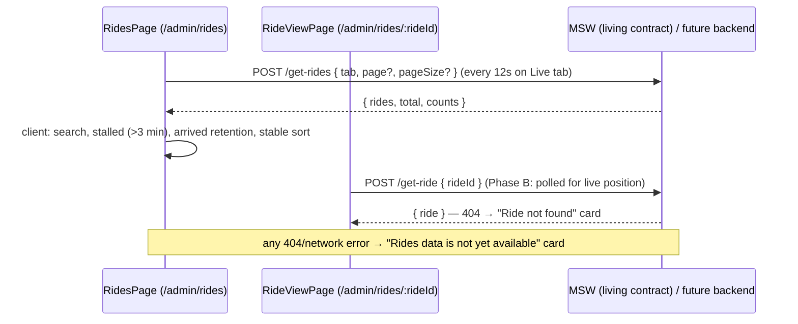

# ADR-0006: Rides Feature — List Page & Live Map

## Status
Accepted (2026-08-07) — Phase A (list page) implemented; Phase B (map page) design ratified, implementation pending.

## Context
The owner locked all ten interview questions for the Rides feature (see `local-docs/ux/active-rides-plan.md`,
rev 2 — the rev-2 changelog is authoritative where the body lags). Backend has **ZERO ride endpoints**
(`docs/design/API-Document.pdf`), so this is mock-first per the ADR-0003 pattern: MSW is the living
contract until the backend commits. Phase A (list page at `/admin/rides` + ride-info view at
`/admin/rides/:rideId`) already shipped in `src/features/rides/` (`RidesPage.tsx`, `RideViewPage.tsx`,
`routes.tsx`); this ADR records the ratified decisions and matches the code — it does not re-open them.
Team is 8 people, frugality-first, bundle band enforced by tests.

## Decision 1 — Endpoints and Ride contract (mock-first)
Two proposed endpoints, mirrored in ADR-0003 footnote 14 (same-commit sync per H6):

- **`POST /get-rides`** — body `{ tab: "live"|"upcoming"|"completed"|"canceled", page?, pageSize? }` →
  200 `{ rides: Ride[], total: number, counts: { live, upcoming, completed, canceled } }`.
  Live/Upcoming client-paginated; Completed/Canceled server-paginated (mock default pageSize 25).
  `counts` returned on every call for tab badges.
- **`POST /get-ride`** — body `{ rideId: string }` → 200 `{ ride: Ride }`; 404 `{ success: false, error: "Ride not found" }`.

`Ride` shape is exactly `src/api/rides.ts` (the canonical types):

```ts
{
  rideId: string,                       // "R-XXXXXX" — 6 uppercase hex
  status: "going_to_pick" | "waiting_for_ride" | "in_transit" | "arrived"
        | "scheduled" | "completed" | "canceled",
  rider: { name, phone }, customer: { name, phone },
  pickup: { label, lat, lng }, dropoff: { label, lat, lng },
  startedAt?, scheduledAt?, completedAt?, canceledAt?: string,   // ISO UTC
  canceledBy?: "rider" | "customer",    // system/admin dropped — owner-locked
  cancelReason?: string,
  fare?: { amount: number, currency: string },   // PKR; visible to BOTH roles
  riderLocation?: { lat, lng, updatedAt: string },
  eta?: { minutes: number, distanceKm: number },
  routePolyline?: string,               // planned route — see open item below
  traveledPath?: string                 // actually-traveled breadcrumbs — Phase B mock-only, pending backend
}
```

- URL constants `API_GET_RIDES_URL` / `API_GET_RIDE_URL` live in `src/api/rides.ts` alongside
  `getRides()` / `getRide()`, all traffic through `src/api/client.ts` (H6). MSW handlers in
  `src/mocks/handlers/rides.ts` import those constants; seeds live only in the handler module.
- `credentials: "include"` per H1 convention (via the shared client).

## Decision 2 — Owner-locked product decisions (ratified, not re-openable without owner)
| # | Decision | Locked value |
|---|---|---|
| 1 | Fare | Table column on all four tabs, **both** Admin and Operator, currency PKR |
| 2 | Completed-ride map | **Static traveled-path map** (actual A→B path, no live rider dot); View button on Live + Completed tabs only |
| 3 | Stalled threshold | **3 minutes** (client-derived from `riderLocation.updatedAt`; `arrived` excluded) |
| 4 | Roles | Admin + Operator see the **identical page** — no role-gated columns; `ProtectedRoute allow=["Admin","Operator"]` |
| 5 | canceledBy | `rider` \| `customer` **only** |
| 6 | Upcoming window | Next **2 hours** |
| 7 | rideId format | **`R-XXXXXX`** (6 chars), searchable |
| 8 | Ride view surface | **Full page** at `/admin/rides/:rideId` (deep-linkable, max map viewport) |
| 9 | CSV export | **None** — removed from scope entirely |

**Open contract item (backend):** Phase B (2026-08-08) added `traveledPath?: string` to `src/api/rides.ts` and seeded it on completed rides in `src/mocks/handlers/rides.ts`. Both `routePolyline` and `traveledPath` use the **same wire shape**: a JSON-stringified array of `[lat, lng]` coordinate pairs (e.g. `"[[24.92,67.09],[24.90,67.07],...]"`), chosen over Google encoded-polyline to avoid a ~25-line decoder (H10 — boring wins). Backend still owes confirmation of: (a) accepting this shape or specifying an alternative, (b) capture cadence for breadcrumb points, (c) storage/retention policy. Until backend confirms, the field is **mock-only / proposed** (mirrored in ADR-0003 fn 14). The Phase B RideMap consumes `traveledPath` on `completed`, falls back to `routePolyline`, then to a straight dashed pickup→dropoff line with a "Route unavailable — showing straight line" note per §3.5.

## Decision 3 — Map stack (Phase B, pending implementation): Leaflet + OSM tiles
Options: (a) **Leaflet + react-leaflet 5** with OSM raster tiles vs (b) MapLibre GL (vector tiles).
**Chosen: (a).**
- react-leaflet 5 is **already in the bundle** (`ActiveRiders.tsx` uses `MapContainer`/`TileLayer`/
  `CircleMarker`/`Popup`) — zero new dependencies, zero band impact from the library itself.
- MapLibre GL costs ~230 kB gzip — a band-shattering addition for smoother zoom/rotation that
  operators do not need on a watch-a-dot page. Rejected on frugality and H10.
- OSM raster tiles are free with mandatory attribution (`© OpenStreetMap contributors`); no API key
  to rotate. Map container wrapped `dir="ltr"` per the existing RTL convention.
- The map page is a **lazy-loaded route chunk** (`React.lazy`) so the list page and the rest of the
  app pay nothing for Leaflet-heavy view code until a ride is opened.
- **Engine seam (Phase B 2026-08-08):** all `react-leaflet` / `leaflet` imports are quarantined behind a hand-authored shadcn-style primitive at `src/components/ui/map.tsx` (exports `Map`, `MapMarker`, `MapPolyline`, plus `MapPosition` / `MapMarkerVariant` / `MapPolylineVariant`). Feature code (`RideMap.tsx` today, others later) consumes only this primitive — verified by `rg 'react-leaflet|from "leaflet"' src/features/` returning zero hits under `rides/`. If the app later standardizes on Google Maps (or MapLibre, Mapbox, etc.), the swap is a single-file rewrite of `ui/map.tsx` behind the same props. `ActiveRiders.tsx` still imports react-leaflet directly — migration to the primitive is a follow-up (out of Phase B scope).
- **Route geometry**: OSRM public demo server is **DEV-ONLY** (its usage policy forbids production
  traffic). Before production: self-host OSRM or have the backend supply the polyline. When geometry
  is unavailable (OSRM down, `routePolyline` absent), fall back to a **straight dashed line** between
  pickup and dropoff plus an info banner — the info bar remains the accessible source of truth.

## Decision 4 — Polling over WebSocket
Options: (a) WebSocket/SSE push vs (b) plain interval polling.
**Chosen: (b) polling.**
- **12 s list poll** on the Live tab (`LIVE_POLL_MS = 12_000` in `RidesPage.tsx`); Completed/Canceled
  fetch on tab switch only. Phase B: per-ride poll on the map page at the same cadence.
- Rationale: there is **no backend** — MSW cannot hold a socket, and inventing a push channel for a
  mock is speculative complexity (H10). Polling is the simplest thing that works, pauses on
  `visibilitychange`, and keeps all state client-side. Stable sort prevents row churn between polls.
- **Revisit trigger**: when the backend lands, re-evaluate push (WebSocket/SSE) in a follow-up ADR if
  position freshness under 12 s becomes an operational requirement.

## Data flow



## Consequences
- Positive: zero new dependencies; frozen-enum contract already exercised by MSW + the shipped list
  page; Phase B map cost isolated to a lazy chunk; owner decisions recorded so QA can block drift.
- Negative: **production shows the "unavailable" state until the backend ships** — `/get-rides` and
  `/get-ride` join the backend handover list (with the `traveledPath` open item and the OSRM
  self-host/backend-polyline requirement). Contract-drift risk mitigated by the ADR-0003
  same-commit sync rule.
- Neutral: polling cadence and the WebSocket question consciously parked with a named revisit
  trigger; completed-ride map fidelity depends on the `traveledPath` backend answer.

## References
`local-docs/ux/active-rides-plan.md` (rev 2, owner-locked) · `src/api/rides.ts` ·
`src/mocks/handlers/rides.ts` · ADR-0003 footnote 14 · ADR-0002 (route guards) ·
ADR-0004 (table pattern) · `src/features/rides/`
